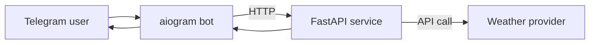

# Weather Telegram Bot (aiogram + FastAPI)

> A Telegram bot that returns the weather for any city. The bot talks to a small FastAPI service that fetches weather data.


## Architecture



The bot and the API run as two services in one `docker-compose.yml`. This split keeps the Telegram layer thin and makes the weather logic reusable from any client.

## Features

- City search with a clean Telegram reply.
- Separate bot and API services.
- docker-compose for one-command startup.

## Tech Stack

| Layer | Technology |
|---|---|
| Bot | aiogram |
| API | FastAPI |
| HTTP client | requests |
| Packaging | Docker, docker-compose |

## Quick Start

```bash
git clone https://github.com/dastonbek8747/weather-telegram-bot-fastapi.git
cd weather-telegram-bot-fastapi
cp .env.example .env      # add BOT_TOKEN and WEATHER_API
docker compose up --build
```

## Environment variables

| Variable | Meaning |
|---|---|
| `BOT_TOKEN` | Telegram bot token from BotFather. |
| `WEATHER_API` | Weather provider API key. |
| `BASE_URL` | Base URL of the weather provider. |

> The bot token that was previously committed here is no longer valid. Rotate any key you ever pushed.

## Project Structure

```
bot/        # aiogram bot
fastapi/    # FastAPI weather service
docker-compose.yml
```

## License

MIT © 2026 Doston Sultonov.
